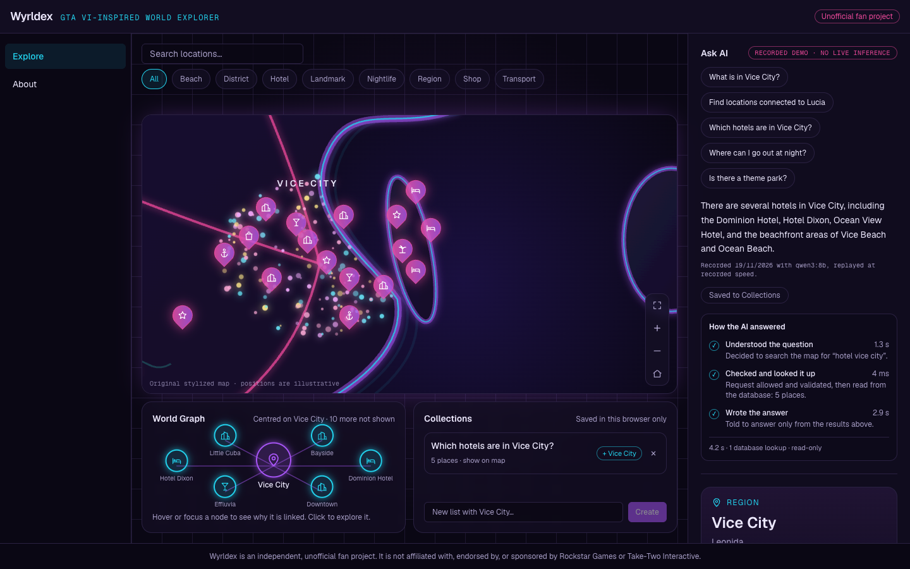
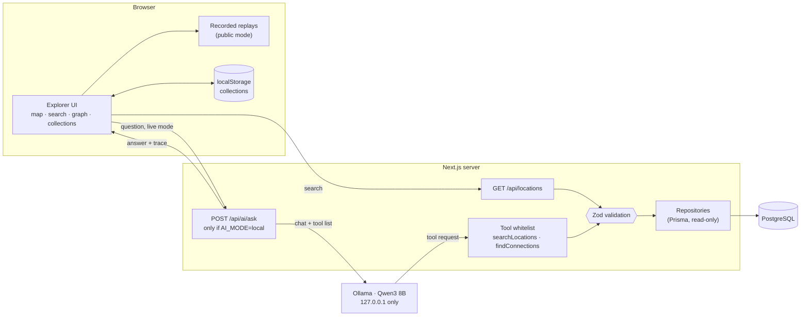
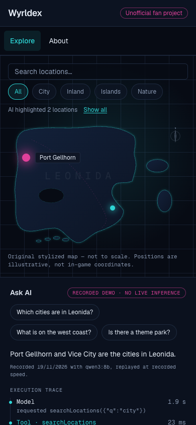

# Wyrldex

[](https://github.com/taimooranwar14/wyrldex/actions/workflows/ci.yml)

**Intelligence for Virtual Worlds.** An AI-native virtual-world exploration platform. First experience: a GTA VI-inspired World Explorer.

> Independent, unofficial fan project. Not affiliated with, endorsed by, or sponsored by Rockstar Games or Take-Two Interactive.



## Status
| Feature | Status |
|---|---|
| Project scaffold + branding | ✅ Done |
| Dashboard shell | ✅ Done |
| Interactive map + filters | ✅ Done |
| PostgreSQL + locations API (`GET /api/locations`) | ✅ Done |
| Search UI wired to API | ✅ Done |
| CI (lint, typecheck, tests with Postgres, build) | ✅ Done |
| Official Leonida regions with sources | ✅ Done |
| Local AI tool call (`POST /api/ai/ask`, developer-only) | ✅ Done |
| Ask AI panel + Execution Inspector + recorded replay | ✅ Done |
| UI polish: map art, About page, favicon | ✅ Done |
| Community data (23 places) + neon map v2 (zoom/pan, icon pins, region labels) | ✅ Done |
| World Graph (characters ↔ places), Collections, context-aware AI questions, `findConnections` tool | ✅ Done |
| Public hosting | 📋 Not yet (runs locally) |

## Quickstart
Requires Node.js 24+ and Docker.

```bash
npm install
cp .env.example .env    # then set a password in both lines
npm run db:up           # start Postgres (localhost only)
npx prisma migrate dev  # create tables
npx prisma db seed      # load Leonida's official regions
npm run dev             # http://localhost:3000 (add `-- -p 3123` if 3000 is taken)

npm run lint && npm run typecheck && npm test
```

Browser smoke test (clicks through every feature in headless Chrome; needs the app running in public mode):

```bash
npm run build && npx next start -p 3124   # in one terminal
node scripts/smoke.mjs http://localhost:3124            # desktop
node scripts/smoke.mjs http://localhost:3124 390 844    # phone size
```

## AI modes
| Mode | When | What happens |
|---|---|---|
| **Recorded replay** (default, public) | `AI_MODE` unset | Preset questions replay traces captured from the real local model, labelled "Recorded demo · no live inference". `POST /api/ai/ask` returns 404. |
| **Live local** (developer) | `AI_MODE=local` in `.env` | Questions go to Ollama on `127.0.0.1` via the server. Never exposed publicly. |

Live mode needs [Ollama](https://ollama.com) and `ollama pull qwen3:8b`. To re-record the replays after changing data or prompts, run the app in live mode and `node scripts/record-replays.mts` (`APP_URL=http://localhost:3123` if not on port 3000). Never hand-edit `src/features/ai/replays.json`.

## Data
- **Confirmed by Rockstar (6):** region names from [Rockstar's official GTA VI site](https://www.rockstargames.com/VI).
- **Spotted by fans (23):** places seen in the official trailers and screenshots, as described by third-party guides ([ScreenRant](https://screenrant.com/gta-6-leonida-vice-city-every-location-revealed/), [gta-6-map.com](https://gta-6-map.com/guides/trailer-locations), [TechNerdiness](https://www.technerdiness.com/gta/gta-6-vice-city-location-guide/)). Labelled "Spotted by fans" until Rockstar confirms them. Fan-invented labels and leaks are left out.

- **Characters (2) and connections (5):** names are official; each character↔place link is community-reported with its own source and note.

Summaries are written in our own words and every record links to its source. Map positions are illustrative, on an original stylized map. No Rockstar logos, screenshots or character art are used.

## Architecture
One Next.js app (a modular monolith, see [ADR-0001](docs/adr/0001-modular-monolith.md)). The AI never touches the database: it can only *request* one of two whitelisted, read-only tools, and the server validates every request before running it.



**Public mode** (no `AI_MODE`): the AI route returns 404 and the panel replays traces recorded from the real local model, labelled as recordings. **Live mode** is developer-only and never exposed.

## Where code runs
Next.js decides per file, not per folder. A file with `"use client"` (and everything it imports) also runs in the browser; everything else stays on the server. Files that must never reach the browser start with `import "server-only"`, which fails the build if a client file imports them.

| Runs | Files |
|---|---|
| Server only | `app/page.tsx`, `app/layout.tsx`, `app/api/**/route.ts`, `features/locations/repository.ts` 🔒, `features/ai/ask.ts` 🔒, `features/ai/ollama.ts` 🔒, `features/graph/repository.ts` 🔒, `lib/db.ts` 🔒, `components/sidebar.tsx`, `components/top-bar.tsx` |
| Browser too | `features/explorer/*` (`explorer.tsx` is the client boundary), `features/ai/ask-panel.tsx` + `replays.json`, `features/graph/world-graph.tsx`, `features/collections/*`, `components/detail-panel.tsx`, `app/error.tsx` |
| Shared | `features/locations/schema.ts` (Zod rules), `features/ai/suggestions.ts`, `features/graph/build.ts`, `lib/brand.ts` |

🔒 = guarded by `server-only`.

## Mobile


## Security and known limitations
- **No public AI.** The model runs only on the developer's machine via Ollama on `127.0.0.1`; without `AI_MODE=local` the AI endpoint does not exist. No API keys anywhere.
- **The AI is read-only.** Two whitelisted tools; every argument is validated with Zod; no SQL is ever generated by the model. Model output is treated as untrusted input.
- **Most data is fan-spotted.** 6 regions are confirmed by Rockstar; 23 places and all 5 character links come from fan guides and are labelled that way. Map positions are illustrative.
- **Collections live in one browser** (localStorage). They do not sync across devices.
- **Not hosted yet.** Run it locally with the quickstart above.

## Docs
- Architecture decisions: [`docs/adr/`](docs/adr/)
- Engineering journal: [`docs/engineering-journal.md`](docs/engineering-journal.md)

## License
[MIT](LICENSE) for the code. Game names and places belong to their owners; this project uses them for identification only.
